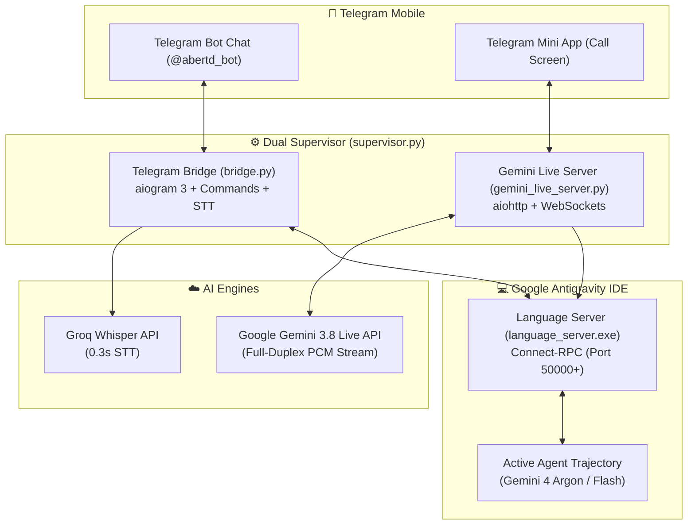

# 🚀 Antigravity Telegram Bridge & Live Voice Assistant

<p align="center">
  <b>Remote-control your active Google Antigravity IDE session from Telegram via Full-Duplex Real-Time Voice (Gemini Live), Text, Photos, and Video Notes.</b>
</p>

<p align="center">
  
  
  
  
  
</p>

---

[English](#features) | [Русский](#особенности-на-русском)

---

## 🌟 Key Features

### 🎙 Full-Duplex Live Voice Assistant (Gemini 3.8 Live Mini App)
- **Real-Time Spoken Dialogue**: Experience true full-duplex conversational voice mode directly inside Telegram via an interactive Telegram Mini App.
- **Ultra-Low Latency (~300ms)**: Sub-second voice responses powered by Google Gemini 3.8 Live WebSocket API (`audio/pcm;rate=16000` in, `audio/pcm;rate=24000` out).
- **Natural Interruptions**: Interrupt the assistant mid-sentence naturally without waiting for turns to finish.
- **Interactive UI**: Dark glassmorphic interface with reactive 3D voice visualizer orb, live speech-to-text transcripts, and mute controls.
- **IDE Code Dispatch**: Speak commands like *"create database migration"* or *"check project tests"* — the assistant confirms via voice and dispatches the task straight into active Antigravity IDE!

### 📱 Telegram Remote Control Suite
- **⚡ Interactive Commands & Menu**:
  - `/call` (or `/live`) — Launch the live conversational voice call screen inside Telegram.
  - `/voice [on|off]` — Toggle neural TTS voice replies for regular chat messages.
  - `/model [auto|flash]` — Inherit model choice from desktop Antigravity (Argon/Flash) or force fast Flash.
  - `/cache` — Context size & cache tax analyzer to preserve token quota.
  - `/screen` (or *«скрин»*) — High-resolution desktop screenshot in real time.
  - `/circle` (or *«кружок»*) — Instant 3-second 1:1 round video note of desktop activity.
  - `/notes` & `/clear_notes` — Manage quick voice and text notes on the go.
  - `/new` & `/session` — Manage active Antigravity conversation binding.
- **🎙 Fast Voice Dictation (Whisper & Gemini STT)**: Voice messages are transcribed in **0.3s** via Groq Whisper-large-v3 or Google Gemini Flash STT.
- **📸 Multimodal Vision**: Send photos, drawings, schematics, or error screenshots from your smartphone camera directly to Antigravity's vision model.
- **🔄 Auto-Discovery (Zero Setup)**: Automatically locates dynamic ports and CSRF tokens across Antigravity restarts via Language Server Connect-RPC.
- **☕ Built-in Keep-Awake**: Native Windows `SetThreadExecutionState` prevents your PC from falling asleep while running headless.

### 🛡 Reliability & Safety Suite (`tools/safety/`)
- **`blast_radius.py`**: Automated rollback & pre-deletion blast radius calculator. Creates instant ZIP rollbacks in `backups/blast_radius/` before destructive file operations.
- **`auto_reflect.py`**: Instant rule and correction persistence into `GEMINI.md`.
- **`cache_tax_monitor.py`**: Analyzes context token weight and warns when it's time to compact conversation memory.

---

## 🏗 Architecture



---

## 🚀 Quick Start

### 1. Clone & Install
```bash
git clone https://github.com/kamil8819/antigravity-telegram-bridge.git
cd antigravity-telegram-bridge
pip install -r requirements.txt
```

### 2. Configure Environment (`.env`)
Copy `.env.example` to `.env` and fill in your keys:
```bash
cp .env.example .env
```

```ini
# Bot Token from @BotFather
TELEGRAM_BOT_TOKEN=123456789:ABCdefGhIJKlmNoPQRsTUVwxyZ

# Gemini API Key (free from https://aistudio.google.com)
GEMINI_API_KEY=AIzaSyYourGeminiApiKeyHere

# Groq API Key (free from https://console.groq.com)
GROQ_API_KEY=gsk_your_groq_api_key_here
```

### 3. Launch
- **Foreground (Terminal)**:
  ```bash
  start.bat
  ```
  *(or `python supervisor.py`)*

- **Silent Background (Windows)**:
  Double-click `start_hidden.vbs` to run silently without any console windows.

---

## 📖 Available Commands

| Command | Description |
|---|---|
| `/call` or `/live` | 🎙 **Open Live Voice Call** (Gemini 3.8 Live Mini App) |
| `/help` | 📖 Interactive cheatsheet of all commands |
| `/voice on` / `off` | 🔊 Toggle voice audio replies for regular text messages |
| `/model [auto\|flash]` | 🧠 Inherit model from PC or force fast Gemini 3.8 Flash |
| `/screen` (or *«скрин»*) | 📸 Capture high-resolution screenshot of current desktop |
| `/circle` (or *«кружок»*) | 🎥 Record 3-second 1:1 round video note of desktop |
| `/cache` | ⚡ Context size and cache tax analyzer |
| `/notes` / `/clear_notes` | 📝 View or clear voice/text thoughts saved on the go |
| `/new` | ✨ Reset conversation binding to newest Antigravity session |
| `/session` | 📌 View active Antigravity Cascade ID |

---

## 🔒 Security & Privacy

- **Zero Hardcoded Secrets**: All tokens, keys, chat IDs, and remote hosts are strictly loaded from environment variables (`.env`) or local `config.json`.
- **Whitelisted Access**: The bridge restricts commands strictly to authorized Telegram User IDs (`ALLOWED_CHAT_ID` or first authenticated user).
- **Safe Tunneling**: Tunnels for the Mini App run over Cloudflare HTTPS, avoiding exposure of local network ports.
- **Git Hygiene**: Pre-configured `.gitignore` prevents accidental commits of `.env`, logs, uploaded media, or audio files.

---

## 📄 License

MIT License. Developed for Google Antigravity IDE and community automation.
